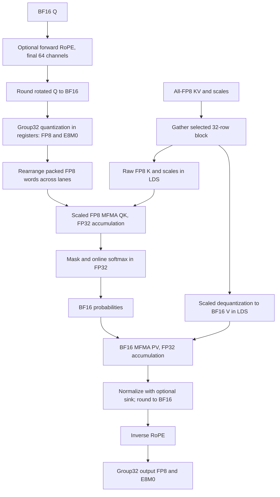

# DSV4.1 fused scaled-FP8 QK, 2026-10-21

> This document records the initial implementation. The current kernel uses
> the [optimized single-V pipeline](fused_dsv41_fp8_qk_optimization.md),
> reducing LDS to 66.25 KiB and improving the measured FP8 full paths by 40–48%.
> Historical timings and the double-V diagram below describe the initial version.

The optional `fp8_qk=True` path quantizes BF16 Q after optional forward RoPE,
executes scaled FP8 QK with FP32 accumulation, and retains BF16 PV. It is
correctness-validated but slower than the existing BF16 QK implementation on
the measured fixtures. The default remains `fp8_qk=False`.

## Interface

```python
out, out_scale, max_logits, lse = fused_dsv41_mxfp8(
    q, pool, indices, indptr, cos, sin, positions,
    q_is_rotated=False, fp8_qk=True,
    # Existing cache_* arguments select the paged cache mode.
)
```

Q is contiguous BF16 `[T,H,512]`, H64 or H128. Both legacy row-packed and paged
all-FP8 KV caches are supported. KV already contains forward RoPE. BF16 KV,
BF16 extend sources and other head counts are rejected in FP8 QK mode.
`q_is_rotated=True` skips Q RoPE but still quantizes BF16 Q.

An alternate entry consumes already prepared Q through the same attention body:

```python
out = fused_dsv41_mxfp8(
    q_fp8, pool, indices, indptr, cos, sin, positions,
    fp8_qk=True, q_is_rotated=True, q_scale=q_scale_uint8,
)
```

Here Q is E4M3FN `[T,H,512]` with 32-byte alignment, and `q_scale` is contiguous
uint8 `[T,H,16]` holding finite E8M0 codes. Supplying scales with BF16 Q,
`fp8_qk=False`, or `q_is_rotated=False` is rejected. The original BF16-Q entry
keeps its 16-byte alignment requirement. Outputs, sinks, CSR bounds, invalid
indices, empty rows and stream handling retain the existing API semantics.
No host scan of scale contents is performed; finite selected inputs remain a
caller requirement.

## Data flow



Each CTA handles one query and 64 heads with four wave64 groups. H128 launches
two CTAs handling disjoint heads. Q preparation runs once per CTA, outside the
KV loop. Each lane first owns one complete group32, computes
`e = ceil(log2(max(amax,1e-30)/448))`, emits E4M3FN `Q/2**e`, and keeps scale
code `e+127`. Four iterations cover D512. This local maximum needs no cross-lane
reduction or extra CTA barrier. Q is not written to global memory in fused mode.

The hardware FP8 operand layout is different from the quantization layout.
For a D128 step and `g=lane/16`, a data operand contains channels
`g*16+[0:15]` followed by `64+g*16+[0:15]`. Scale lane g supplies the scale for
the contiguous channels `g*32+[0:31]`. Packed Q words are rearranged using
`ds_bpermute`; K is read as two aligned 16-byte pieces. This mapping was checked
with a standalone scaled-MFMA probe and a dense oracle with varying group
scales. Uniform scales alone would not detect an incorrect association.

K is operand A and Q is operand B. Score lane `lane%16` owns a head, and each
lane holds four scores per N16 tile. Two N16 tiles times four D128 steps issue
eight `v_mfma_scale_f32_16x16x128_f8f6f4` instructions per wave per KV block.
PV uses 32 BF16 MFMA instructions per block. These are verified static loop-body
counts, not total dynamic instruction counts for a request.

## Pipeline and resources

Two BF16 V slots use 33,792 bytes each. Two raw K slots use 16,896 bytes each:
32 rows of 512 FP8 data bytes plus 16 E8M0 bytes, with row stride 528. K loads are
16-byte aligned. Total static LDS is 101,376 bytes (99 KiB), versus 66 KiB for
the current BF16 path. The selected binary has zero private/scratch storage
for all twelve new specializations. Code-object resource details are archived
in `isa/summary.json`; this does not establish a measured occupancy value.

```mermaid
sequenceDiagram
 participant M as Global cache
 participant R as Registers
 participant L as Double-buffered LDS
 participant A as Attention
 M->>R: Prefetch initial FP8 KV and scales
 R->>L: Store raw K; dequantize and store BF16 V
 Note over R,L: Wait and CTA barrier
 loop Each 32-row KV block
  M->>R: Prefetch next raw KV block
  L->>A: Read current raw K and scales
  A->>A: FP8 QK with register Q
  Note over R,A: Compiler scheduling fence
  R->>L: Commit next K and BF16 V to other slots
  A->>A: FP32 online softmax; BF16 P
  L->>A: Read current BF16 V
  A->>A: BF16 PV accumulation
  Note over R,A: Wait, CTA barrier, swap slots
 end
```

The scheduling fence prevents the next-tile VMEM waits/dequantization from
moving before QK. It is a compiler constraint, not another hardware barrier.
The order-sensitive BF16 PV partial waits and scheduling barriers are retained.
The selected revision also pads raw rows and interleaves two independent QK
accumulator chains. Together these changes reduced latency about 14-16% versus
the initial correct FP8 implementation in separate runs, but did not beat BF16.

## Same-run full-path comparison

MI355X GPU6, clocks unlocked, microseconds. H64 uses K640; H128 uses K1152.
All paths include Q RoPE through output quantization. Both FP8 alternatives
include Q group32 quantization. External-Q and fused-Q modes use the same
attention implementation and output processing; their output bytes agree.
PR6675 is pinned at `b92f3cc9eeff2b5a5c56741a15da003dc5640d2e` and receives native
row-packed KV, so compare it with our row-packed column. Cache layout
conversion, cache writer, GEMM, metadata creation and allocations are excluded.
PR optional LSE output is not requested; our fused path also writes max/LSE.

| T | H | S | BF16 paged | FP8 paged | External Q + FP8 paged | FP8 row | PR full native |
|---:|---:|---:|---:|---:|---:|---:|---:|
| 560 | 64 | 8192 | 115.88 | 216.14 | 229.22 | 224.19 | 113.86 |
| 560 | 64 | 32768 | 120.81 | 224.09 | 236.97 | 227.91 | 115.93 |
| 960 | 64 | 8192 | 144.92 | 309.31 | 328.71 | 318.05 | 173.06 |
| 960 | 64 | 32768 | 147.57 | 313.79 | 333.99 | 320.28 | 178.72 |
| 320 | 128 | 8192 | 189.92 | 362.17 | 375.44 | 365.93 | 154.14 |
| 320 | 128 | 32768 | 196.01 | 370.32 | 384.70 | 376.81 | 157.75 |

Q preparation fusion saves roughly 13-20 us on these paged fixtures. The FP8
kernel as a whole remains about 1.8-2.1 times slower than BF16. Increasing LDS
and register requirements, additional raw-K traffic and the less mature FP8
pipeline remain optimization targets. No claim is made that a particular one
of these factors alone explains the remaining slowdown.

Supplemental synthetic shared-cache cases use S32768 and K640 for both head
counts. They are not the user's B300 fixtures and do not establish cross-GPU
performance equivalence.

| T | H | BF16 paged | FP8 paged | External Q + FP8 paged |
|---:|---:|---:|---:|---:|
| 1 | 64 | 45.82 | 64.22 | 66.67 |
| 64 | 64 | 51.35 | 69.56 | 72.42 |
| 1024 | 64 | 130.44 | 283.01 | 300.71 |
| 1 | 128 | 46.10 | 64.47 | 66.78 |
| 64 | 128 | 52.95 | 71.57 | 76.20 |
| 1024 | 128 | 251.19 | 560.65 | 605.45 |

## Validation and reproduction

- 253 tests pass: the existing 219 regressions and 34 new FP8/quantized-Q tests.
- The new dense oracle independently quantizes Q after the BF16 RoPE boundary;
  max/LSE use `rtol=1e-4, atol=3e-5`. Pre-cast output relative L2 is below 0.005
  in the new dense tests. No BF16-Q bit-equality assertion was relaxed to make
  an FP8 result pass.
- The six original fixtures additionally check dense attention on three queries
  each. Paged versus packed, and fused versus externally prepared Q, agree
  bit-for-bit within FP8 mode. Graph replay checks poison output buffers first.
- Post-quantization output relative L2 versus BF16 QK ranges from
  0.007399 to 0.007475 on the six original fixtures. This is a precision
  difference, not a model-level accuracy evaluation.
- All 12 new compiled specializations contain scaled FP8 QK and BF16 PV
  instructions, with no scratch instructions.

From this checkout, run the four `op_tests/test_fused_dsv41*.py` suites with
`HIP_VISIBLE_DEVICES=6 GPU_ARCHS=gfx950`. Full benchmark reproduction additionally
requires the pinned PR checkout, retained BF16 binary and historical fixture
generator recorded under `/home/jun_chen2_qle/yzhou_aiter/fp8-qk-20261021`. The archived `benchmark.py`,
`generated_bench_case.py`, `shared_bench.py`, JSON samples and pytest XML describe
the exact run. Measurements use balanced graph orders, 4 calls per graph and
8 replays per event sample, with medians of visit medians and unique binary
module namespaces. Intermediate tensor storage is retained by every native call.

Selected binary: `/home/jun_chen2_qle/yzhou_aiter/fp8-qk-20261021/jit/v4/module_fused_dsv41_mxfp8.so`

SHA256: `30d218a4e35ef81a2fd6372b6612fe65116505d07df115492ee8a59d431f5bf5`

FP4 KV, split-KV parallelism, model-forward integration and model-quality
validation are outside this implementation. This opt-in path is a functional
FP8-QK baseline for further optimization; use the default BF16 path for the
measured workloads.
