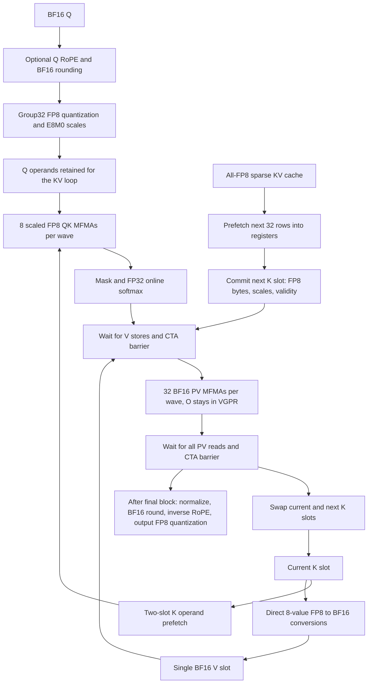

# DSV4.1 FP8 QK pipeline optimization, 2026-10-21

> Follow-up: [softmax FMA and H128 architecture experiments](fused_dsv41_fp8_qk_h128.md).


This update lowers full-path FP8 latency by 40–48% on the original six MI355X
fixtures relative to commit `3881a17`. QK remains scaled E4M3FN with E8M0
group32 scales, softmax and accumulation remain FP32, and PV remains BF16.
The public API and default `fp8_qk=False` are unchanged. FP8 is still
10–13% slower than BF16 QK on the six paged fixtures, so FP8 is still opt-in.

## What changed

1. Use explicit VGPR constraints for FP8 QK and BF16 PV MFMA. The old compiled
   loop moved 128 output accumulators between VGPRs and AGPRs at the QK/PV
   boundary. The selected kernel has no accvgpr read/write instructions.
2. Retain two FP8 K slots but materialize only one BF16 V slot. Each K slot
   contains 32 rows of 528 bytes plus 128 bytes of validity flags. Total LDS
   drops from 101,376 to 67,840 bytes (99 to 66.25 KiB).
3. Dequantize directly from each 8-value K piece into V. Reconstructing a full
   RawTile increased register lifetimes and erased most of the single-V gain.
   Invalid K rows are stored as zero values with scale 127, so V conversion
   needs no divergent validity branch; score masking reads the separate flags.
4. Pipeline two K operands through eight QK MFMAs using partial LDS waits.
   Keep the existing BF16 PV wait/fence ordering. Group the scale writes under
   a single lane predicate instead of interleaving predicates with data writes.

All twelve specializations use 244–245 VGPR in compiler metadata, zero AGPR,
and zero private segment/scratch instructions. The old metadata reports 384
VGPR and 128 AGPR; these two fields are not added together here.

The local ROCm 7.2.4 clang 22 probe reports that `amdgpu_pin_vgpr/agpr` are
unsupported and ignored. An attribute-only candidate generated unchanged
instructions and was discarded. This describes our local compilation; the
PR attention benchmark loads its checked-in prebuilt HSACO.

## Pipeline and synchronization



```mermaid
sequenceDiagram
  participant GM as Global KV cache
  participant KR as Two raw K LDS slots
  participant QK as QK registers
  participant V as One BF16 V LDS slot
  participant O as O accumulators in VGPR
  Note over GM,O: Prologue: prepare Q once, load K0, CTA barrier
  loop Each 32-row KV block i
    GM->>QK: Prefetch raw K(i+1) into temporary registers
    KR->>QK: Pipeline K(i) operands, two 16-byte reads plus scale per operand
    QK->>QK: Scaled FP8 QK and score masking
    QK->>KR: Commit prefetched K(i+1) to the other slot
    KR->>V: Convert K(i) pieces directly to BF16 V(i)
    QK->>QK: Online softmax, BF16 P, conditional O rescale
    Note over KR,O: Wait LDS stores, CTA barrier
    V->>O: BF16 PV with the existing transpose-read pipeline
    Note over KR,O: Wait PV reads, CTA barrier; V can now be reused
  end
```

The single V slot adds one CTA barrier per KV block. The barrier before PV
publishes all V stores across waves; the loop-end barrier prevents an early
wave from overwriting V while another wave still consumes it. Raw K slots
are separate from V, so materializing V cannot destroy current QK inputs.
The output epilogue reuses V storage only after the final block's barrier.

For QK, each K operand uses two `ds_read_b128` and one `ds_read_u8`. The
steady-state `lgkmcnt(3)` leaves the next operand in flight. The compiler
inserts a stronger initial wait when it moves scale reads. ISA inspection
confirms this order; changing the read layout requires rechecking the waits.

## Full-path performance

MI355X GPU 6, serial jobs, clocks unlocked, microseconds. T is batch times
query tokens per request; H is query heads; S is the long-cache scope length.
Selected K is 640 for H64 and 1152 for H128; all selected KV is FP8.

Every full path includes Q RoPE, Q quantization where applicable, attention,
inverse RoPE and output quantization. PR full includes external Q preparation.
Compare native PR row-packed KV with our **row** column. No allocation, cache
writer, layout conversion, GEMM or metadata construction is timed. The fused
kernel writes max/LSE; PR does not request optional LSE. Timings use balanced
graph orders, median of visit medians and poisoned-output replay checks.

| T | H | S | old FP8 paged | new FP8 paged | reduction | BF16 paged | new FP8 row | PR full row |
|---:|---:|---:|---:|---:|---:|---:|---:|---:|
| 560 | 64 | 8192 | 217.60 | 128.64 | 40.9% | 115.88 | 133.60 | 113.64 |
| 560 | 64 | 32768 | 223.20 | 133.52 | 40.2% | 121.01 | 136.53 | 115.18 |
| 960 | 64 | 8192 | 309.21 | 161.90 | 47.6% | 144.99 | 165.32 | 175.01 |
| 960 | 64 | 32768 | 312.80 | 163.96 | 47.6% | 147.32 | 166.83 | 179.01 |
| 320 | 128 | 8192 | 361.43 | 208.54 | 42.3% | 189.55 | 215.35 | 153.86 |
| 320 | 128 | 32768 | 370.28 | 223.04 | 39.8% | 197.51 | 236.72 | 156.72 |

At T960/H64 our new row path is 5.5–6.8% faster than PR full. At T560/H64
it is 17.6–18.5% slower; H128 is 40.0–51.0% slower. PR attention alone is
81–128 us and excludes both Q preparation and the output epilogue.
Q preparation fusion still saves 13.6–22.8 us on the six paged fixtures
relative to external Q preparation using the same FP8 attention body.

Supplemental synthetic shared cache, S32768/K640, paged format:

| T | H | old FP8 | new FP8 | BF16 | external Q + new FP8 |
|---:|---:|---:|---:|---:|---:|
| 1 | 64 | 64.27 | 51.23 | 45.72 | 53.45 |
| 64 | 64 | 69.41 | 56.69 | 50.98 | 59.68 |
| 1024 | 64 | 283.25 | 148.84 | 131.80 | 167.45 |
| 1 | 128 | 64.54 | 51.43 | 46.04 | 53.45 |
| 64 | 128 | 71.83 | 59.12 | 53.27 | 62.81 |
| 1024 | 128 | 560.36 | 285.58 | 250.91 | 335.59 |

These are AMD synthetic fixtures, not the user's B300 fixture. Small T1/T64
also improves by 18–20% over the old FP8 path. The simpler double-V VGPR
candidate was slower than the selected implementation on every shared case.

## Profiling evidence

Separate rocprofv3 counter passes on T960/H64/S8192/K640, paged format,
three measured dispatches per pass:

| Counter | old | selected |
|---|---:|---:|
| MeanOccupancyPerCU, average resident waves | 3.516 | 6.442 |
| OccupancyPercent | 10.99% | 20.13% |
| SQ_INSTS_VALU | 51,701,760 | 29,441,280 |
| SQ_INSTS_LDS | 9,922,560 | 10,306,560 |
| SQ_INSTS_MFMA | 3,072,000 | 3,072,000 |
| SQ_WAVES | 3,840 | 3,840 |
| LDSBankConflict, tool-defined metric | 3.941 | 8.684 |

The higher measured residency and 43% fewer VALU instructions explain why
the extra V barrier and 3.9% more LDS instructions are worthwhile. This does
not establish a single exclusive bottleneck. The tool's LDSBankConflict
metric increases; it is not a count of conflicts or a claim of doubled
raw conflicts. Profiling durations include counter-collection effects and
are not substituted for the balanced graph timings above.

## Validation and remaining work

- 253 tests pass: all 219 prior regressions plus 34 FP8 QK tests. These cover
  varying group scales, ragged/invalid/empty rows, tails and long KV, H64/H128,
  packed/paged caches, prepared Q, graph poisoning and nondefault streams.
- All six original and six shared benchmarks preserve output FP8 bytes and
  scales bit-for-bit relative to the previous FP8 implementation. Original
  fixtures also check max/LSE against it at rtol=atol=1e-6.
- Independent quantized-Q dense oracles retain their original tolerances.
  Internal and external Q preparation outputs remain bit-exact. FP8 versus
  BF16 QK output relative L2 remains about 0.00740–0.00748; this is not a
  model-level accuracy evaluation.
- All 12 ISA variants contain 8 scaled FP8 QK and 32 BF16 PV static loop
  instructions, no scratch and zero AGPR. After measurement, source polishing
  changes comments only; normalized C++ tokens match the compiled candidate.

The next major architecture experiment is an N64 attention tile and better
P/V work distribution, following the PR's dedicated FP8 pipeline. That could
reduce softmax/barrier frequency; it has not been implemented or benchmarked
in this change. The current N32 kernel still trails BF16 and PR on several
shapes, so this update does not change the default precision path.

## Reproduction and evidence

Base commit: `3881a17ac14fba1865900da56f1d842e81a90bc1`.
PR comparison commit: `b92f3cc9eeff2b5a5c56741a15da003dc5640d2e`.
The selected candidate is `qkpipe` under
`/home/jun_chen2_qle/yzhou_aiter/fp8-qk-opt-20261021`.
That directory holds serial GPU 6 runners, all candidate sources, tests,
benchmark adapters and raw profiler databases. Database and binary SHA256
values are recorded alongside the results. Use a fresh `AITER_JIT_DIR` after
any source change; an existing .so is not automatically rebuilt.

```bash
HIP_VISIBLE_DEVICES=6 GPU_ARCHS=gfx950 MAX_JOBS=8 \
AITER_JIT_DIR=/tmp/dsv41-fp8-qk-new-build \
AITER_CK_DIR=/home/jun_chen2_qle/yzhou_aiter/aiter/3rdparty/composable_kernel \
PYTHONPATH=$PWD:$PWD/op_tests OMP_NUM_THREADS=4 \
/opt/venv/bin/python3 -m pytest \
  op_tests/test_fused_dsv41_mxfp8.py op_tests/test_fused_dsv41_paged.py \
  op_tests/test_fused_dsv41_bf16.py op_tests/test_fused_dsv41_fp8_qk.py -q
```

Measured JSON and source provenance are in
`experiments/20261021/fp8_qk_optimization/`. The archived benchmark adapters
reuse the pinned fixture and PR helper checkouts at the recorded remote paths;
they are not standalone portable benchmarks. The tests above are the native
repository regression entry point.
