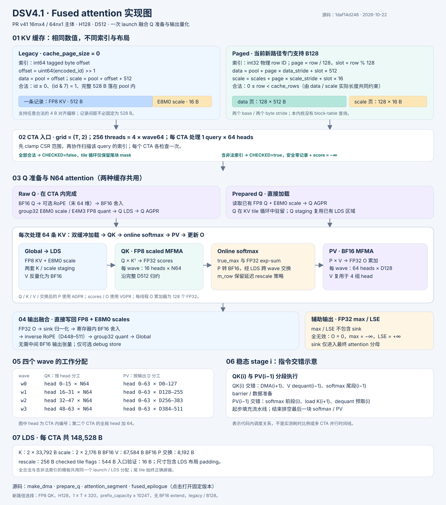

# DSV4.1 fused attention：legacy / paged 与实现细节

对应实现提交 [`1daf14d24698d9736960cc80443724aa1e853e60`](https://github.com/yzhou103/aiter/commit/1daf14d24698d9736960cc80443724aa1e853e60)。

[交互版 HTML](fused_dsv41_pr_v41_implementation.html) 下载后可直接在浏览器离线打开。可切换缓存、Q 输入、索引分支高亮，也可计算页边界两侧的寻址示例。

两者保存相同的逻辑 KV：D512 的 FP8 数据（512 B）与 group32 E8M0 scale（16 B）。区别在于 prefix 索引的含义、数据布局与地址生成；后续 N64 attention 算法相同。

| 项目 | Legacy | Paged（当前新路径 B128） |
|---|---|---|
| prefix 索引 | int64，带标记的字节偏移 | int32，物理 row ID |
| data | pool + (uint64(id) >> 1) | pool + (row / 128) × data_stride + (row % 128) × 512 |
| scale | data + 512 | scales + (row / 128) × scale_stride + (row % 128) × 16 |
| 合法条件 | id ≥ 0，(id & 7) == 1，完整记录在 pool 内 | 0 ≤ row < cache_rows；host 按两个实际 byte view 限制行数 |
| 布局约束 | 每条记录的 data 和 scale 相邻；起点 4 B 对齐 | 两个 base 和两个独立 int64 byte stride，可分配在不同内存 |

legacy 不是逻辑 row 编号。紧密排布时 encoded_id = row × 1056 + 1；若 pool 有 4 B 头部，则 encoded_id = row × 1056 + 9。接口也允许其他合法偏移。

paged 内核直接从物理 row 计算 page / slot，没有内部 block-table 查询。B128 是编译期特化，不能将其性能差距直接解释为动态除法成本。原接口的其他 page size 继续走旧 kernel。

本图以每 CTA 的 64 heads 为单位；H128 启动两个 CTA / query。四个 wave 在 QK 中按 16 heads 分工，在 PV 中改按 D128 分工，并通过 LDS 交换 P。Raw Q 的 RoPE/量化和输出 inverse RoPE/量化都在同一 kernel 内完成。

先 clamp CSR 范围并扫描索引，再选择 CHECKED=false / true 模板。全部有效路径免去每 tile 的有效性 flags；尾块仍 mask。含无效索引路径加载安全零记录，并将其 score 设为 −∞。全无效时 O=0、max=−∞、LSE=+∞。

softmax 的 exp-sum 保留 FP32，P 转 BF16 后参与 PV。true_max 单独维护；内部 m_row 保留 PR 的延迟 rescale（log2 域阈值 8）。max/LSE 不包含 sink；sink 只进入最终 attention 分母。

| 完整路径延迟，µs | S8192 | S32768 |
|---|---:|---:|
| Legacy | 141.633 | 144.567 |
| Paged B128 | 145.681 | 151.670 |
| Paged 多用时 | 4.048（2.9%） | 7.103（4.9%） |

MI355X gfx950 GPU6，未锁频，T320 / H128 / 每 query K1152；含 Q RoPE/量化、attention、输出 inverse RoPE/量化及 max/LSE；不含分配、GEMM、cache writer 或布局转换。引用已有测量，本文档没有重跑性能。布局、访存局部性、地址计算和生成代码的具体影响尚未隔离 profiling。

源码入口：[寻址](https://github.com/yzhou103/aiter/blob/1daf14d24698d9736960cc80443724aa1e853e60/csrc/kernels/mla/fused_dsv41/pr_v41/mla_v41_prefill_fused.hpp#L1142)、[Q 准备](https://github.com/yzhou103/aiter/blob/1daf14d24698d9736960cc80443724aa1e853e60/csrc/kernels/mla/fused_dsv41/pr_v41/mla_v41_prefill_fused.hpp#L967)、[attention_segment](https://github.com/yzhou103/aiter/blob/1daf14d24698d9736960cc80443724aa1e853e60/csrc/kernels/mla/fused_dsv41/pr_v41/mla_v41_prefill_fused.hpp#L1059)、[输出融合](https://github.com/yzhou103/aiter/blob/1daf14d24698d9736960cc80443724aa1e853e60/csrc/kernels/mla/fused_dsv41/pr_v41/mla_v41_prefill_fused.hpp#L1006)、[索引验证](https://github.com/yzhou103/aiter/blob/1daf14d24698d9736960cc80443724aa1e853e60/csrc/kernels/mla/fused_dsv41/pr_v41/mla_v41_prefill_fused.hpp#L1403)、[dispatch](https://github.com/yzhou103/aiter/blob/1daf14d24698d9736960cc80443724aa1e853e60/csrc/kernels/mla/fused_dsv41/pr_v41_dispatch.hpp#L12)。
