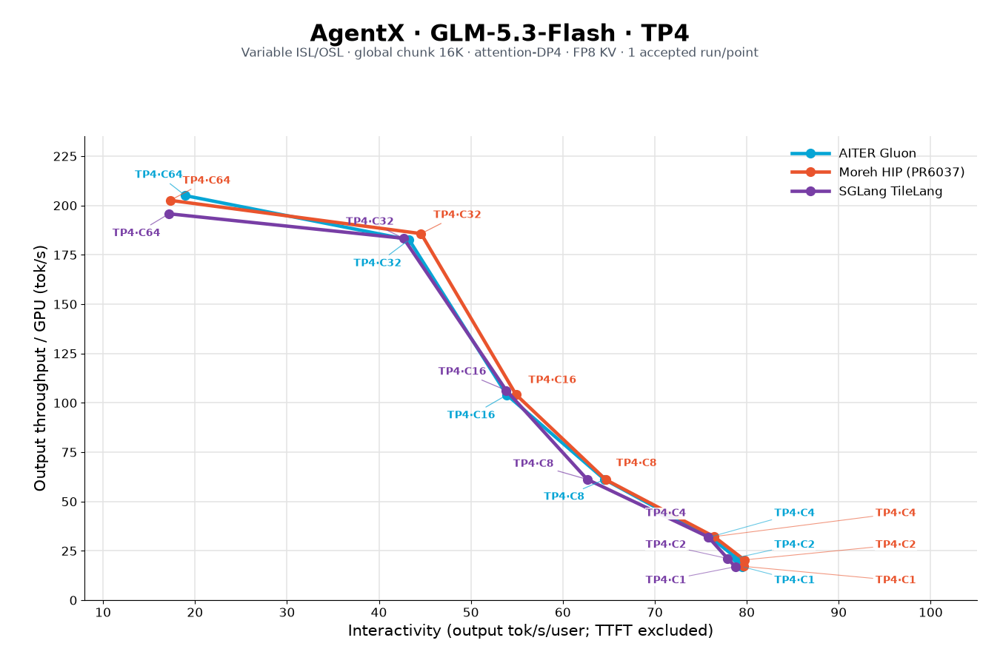

# FP8 sparse MLA on gfx950

`sparse_mla_fp8_fwd` implements sparse attention over a shared FP8 latent K/V
pool, with BF16 query conversion inside attention and BF16 output. It targets
H64/D512 on gfx950 (MI355X), without appended RoPE. The API is opt-in; an engine
must explicitly route eligible calls and provide its own fallback.

```python
import torch
from aiter import sparse_mla_fp8_fwd, allocate_sparse_mla_fp8_workspace

q = torch.randn((8, 64, 512), device="cuda", dtype=torch.bfloat16)
kv = torch.randn((8192, 512), device="cuda", dtype=torch.bfloat16).to(torch.float8_e4m3fn)
indices = torch.randint(8192, (8, 2112), device="cuda", dtype=torch.int32)
indices[:, 2051:] = -1
out = torch.empty_like(q)
workspace = allocate_sparse_mla_fp8_workspace(q)

# Warm the JIT before capture. Supplying storage avoids repeated allocation.
out, _ = sparse_mla_fp8_fwd(q, kv, indices, 1 / 16, out=out, workspace=workspace)
graph = torch.cuda.CUDAGraph()
with torch.cuda.graph(graph):
    out, _ = sparse_mla_fp8_fwd(q, kv, indices, 1 / 16, out=out, workspace=workspace)
# Update q, kv and indices in place, then replay for the same shapes.
graph.replay()
```

## Input and numerical contract

| Argument | Contract |
|---|---|
| Q | BF16 or `float8_e4m3fn`, `[Q,64,512]`, Q from 0 through 16384 |
| Q layout | Unit inner stride, non-overlapping rows, pointer and row strides aligned to 16 bytes |
| KV | Contiguous `float8_e4m3fn`, `[slots,512]`, `[pages,page_size,512]`, or `[slots,1,1,512]` |
| Slot IDs | Contiguous int32 `[Q,K]` or `[Q,1,K]`, capacity K from 0 through 2176 |
| Scales | Finite positive Python scalars: `softmax_scale`, `q_scale`, `kv_scale` |
| O | Contiguous BF16 `[Q,64,512]` |
| Optional LSE | Contiguous FP32 `[Q,64]`, natural logarithm |
| Workspace | Opaque flat BF16 partial output and FP32 partial LSE from the allocator |

Slot IDs address physical rows in the flattened pool. Negative and out-of-range
IDs are masked; duplicate IDs retain their multiplicity. K is the array capacity,
including padding. Empty selections produce O=0 and LSE=-infinity. KV addresses
use 64-bit arithmetic, including for pools larger than 4 GiB.

BF16 Q is encoded as `FP8(Q.float() / q_scale)`. FP8 Q is already encoded and is
not quantized again. Decoding scales apply to Q, K and V; `kv_scale` is used in
both the score and value paths. The E4M3FN conversion uses round-to-nearest-even,
signed zero and gradual underflow; overflow produces NaN, matching the PyTorch
cast. Choose a scale that keeps model activations representable. P is encoded
as FP8 with decoding scale 1/256. There is one FP8 Q component and one QK
computation. Accumulators, softmax and LSE are FP32; split partial O and final O
are BF16.

Numerical coverage separates quantization error from a tighter arithmetic check:

- General normal-distributed inputs are compared with independent ideal FP64
  attention after Q encoding. Per-head relative RMS is at most 0.07, with
  elementwise atol/rtol=0.07; this includes FP8 P and BF16 partial-store error.
  LSE has a separate atol=5e-4, rtol=1e-5 gate, since P and partial O rounding
  do not affect it.
- A second independent Torch reference uses FP64 matmuls, explicit FP8 P
  rounding at scale 1/256, and BF16 split-store rounding. Two seeds of dyadic
  Q/KV inputs make QK sums exactly representable, avoiding amplification of
  QK roundoff at discontinuous FP8 P rounding boundaries. Every row/head is
  checked at dispatch boundaries through Q129, including compact Q8, with
  full valid selections and tail-only selections at K=2112 and K=2176.
  The gate is per-head relative RMS <=0.005, elementwise atol=0.002,
  rtol=0.005, and LSE atol=1e-5, rtol=1e-6. A deliberately perturbed output
  verifies that the gate rejects a 2% output error.

The ideal FP64 checks cover all rows through Q129. Larger Q checks use 32
stratified rows and both sides of each 2048-row boundary; the Q4096/8192/16384
chunk-equivalence tests additionally check **every random-input row** against
ideal FP64 attention in bounded batches. Chunk equivalence remains a separate
consistency check. An analytic single-selected-slot test also checks every
output element and LSE at those three large Q sizes, using row-dependent slots
and valid positions throughout the tail, including the last capacity entry.
Its output check is exact BF16 equality and does not call another HIP kernel
as the oracle. Both padded and fully valid capacities are tested; graph replays
include valid tails, masked tails, and all-invalid selections.

These checks do not imply equivalence to BF16 attention or establish model
accuracy. The previously reported 190 passes were local validation, not a
successful GitHub GPU CI run.

The operator uses the current HIP stream. Validation reads tensor metadata,
not GPU values. Graph capture fixes the shape-dependent dispatch and replay
reads updated tensor contents. Outputs and workspace must not overlap any
input or each other. Unsupported devices and metadata raise errors.

## Dispatch and implementation

| Q | Heads per CTA | K tile | Splits | Main loading path |
|---|---:|---:|---:|---|
| 1–6 | 16 | 128 | 17 | Small-query head tiles |
| 7–12 | 32 | 128 | 9 | Two KV tiles prefetched around Q conversion |
| 13–21 | 32 | 128 | 6 | Rotating KV buffers |
| 22–23 | 32 | 128 | 4 | Rotating KV buffers |
| 24–42 | 64 | 128 | 6 | Rotating KV buffers |
| 43–64 | 64 | 128 | 4 | Rotating KV buffers |
| 65–128 | 64 | 128 | 2 | Streaming double buffer |
| 129–16384 | 64 | 128 | 1 | Streaming double buffer, direct output |

Q8 uses head-major partial LSE and a packed FP32 reducer. Other split paths use
their corresponding split-major layout. Workspace is opaque so callers do not
need to reproduce these layouts. No workspace initialization kernel is required.
The 2112-entry selection capacity has a specialization in the prefetch path;
other supported capacities use the general path.

## Reproduction

The HIP implementation uses AITER's ctypes JIT and HIP intrinsics/assembly; it
does not require HipKittens. Build with `GPU_ARCHS=gfx950`. Warm the operator
before Graph capture. Run correctness and replay checks with:

```bash
GPU_ARCHS=gfx950 python -m pytest -q op_tests/test_sparse_mla_fp8.py
```

The benchmark accepts BF16 Q for HIP and Gluon, and optionally SGLang TileLang
with `--tilelang`. Each path includes its Q conversion and ends with BF16 O ready.
The TileLang option requires SGLang and TileLang on `PYTHONPATH`; it records the
TileLang source hash in `config.json`. It uses a random 5,608,046,592-byte FP8 KV
pool, 2051 valid slots per query, capacity 2112, and `-1` padding. The default
queries are every power of two from 1 through 16384; `--all-small` additionally
covers Q1–64 individually and Q65.

```bash
GPU_ARCHS=gfx950 python op_tests/op_benchmarks/bench_sparse_mla_fp8.py \
  --all-small --output /tmp/sparse-mla-fp8-results
```

With a pinned SGLang checkout installed, add `--tilelang` to measure its
`tilelang_sparse_fwd` path on the same input tensors and in the same phases.

Each of two fresh Q seeds is measured in forward and reverse order. Each phase
uses 30 timing samples, with 20 calls captured per HIP Graph. The reported time
is the median of the four phase medians. Compilation, host allocation and
Python execution are excluded; captured GPU work is included. Raw samples,
launch tile size, configuration and per-phase numerical checks are saved.

HIP uses fixed Q scale one. Gluon uses dynamic tile quantization, checked against
its source-order quantized-Q reference. That reference does not assert bitwise
identity between Torch division and the hardware reciprocal instruction.

`speedup = Gluon_us / HIP_us - 1`. Logical KV bandwidth is
`Q * valid_K * 512 / HIP_us / 1e6` TB/s: one selected FP8 KV payload per query.
The additional KV+Q/O payload rate uses
`Q * (valid_K * 512 + 2 * 64 * 512 * 2) / backend_us / 1e6` TB/s; the second
term counts the BF16 Q read and BF16 O write once. Both rates are available
for HIP and Gluon and, with `--tilelang`, TileLang. They exclude repeated head
reads, index and intermediate traffic, including TileLang's separate FP8 Q cast.
Neither rate is measured HBM traffic. Operator timings do not establish
serving throughput.

## AgentX end-to-end serving

The opt-in SGLang integration was measured on GLM-5.3-Flash with four MI355X
GPUs, TP4/attention-DP4, global chunk 16384 (4096 per rank), BF16 Q/O, FP8
KV, and a variable-length 393-trace AgentX pool (seed 42). For each backend
and concurrency, requests were issued for 3600 seconds, then all issued
requests were allowed to complete. Each of the 21 points below is one accepted
run; the completed request sets and prefix-cache histories are not identical.

Output throughput is successful output tokens divided by the span from first
request start to last response end, then by four GPUs. Interactivity in the
figure is `1000 / median(full-response inter-token latency in ms)` over valid
requests; TTFT is excluded. Higher is better on both axes.

| Concurrent sessions | TileLang output tok/s/GPU | Gluon output tok/s/GPU | HIP output tok/s/GPU | HIP vs Gluon | HIP vs TileLang |
|---:|---:|---:|---:|---:|---:|
| 1 | 16.935 | 17.035 | 17.126 | +0.53% | +1.13% |
| 2 | 21.119 | 21.450 | 20.408 | -4.86% | -3.37% |
| 4 | 32.055 | 32.008 | 32.207 | +0.62% | +0.47% |
| 8 | 61.207 | 61.168 | 61.019 | -0.24% | -0.31% |
| 16 | 106.320 | 104.006 | 104.150 | +0.14% | -2.04% |
| 32 | 183.376 | 182.625 | 185.739 | +1.71% | +1.29% |
| 64 | 195.796 | 205.013 | 202.603 | -1.18% | +3.48% |



The Gluon and HIP paths were verified on all four workers without a fallback.
GLM-5.3-Flash uses sparse MLA in 11 of its 45 text layers; other attention,
MoE, indexer, and scheduler work is unchanged. Prefix-cache hit rates at
C1–32 were 94–97%, so a smaller whole-model effect is plausible, but the
sparse-MLA share of GPU time was not measured. At C64 cache hits fell to
85–86%, and TileLang's output rate was 4.50% below Gluon's.
Each point is one closed-loop run with a different set of completed requests
and cache history. Small gaps and reversals such as HIP versus Gluon at C2
(-4.86%), C32 (+1.71%), and C64 (-1.18%) cannot be attributed to the kernel
alone.
